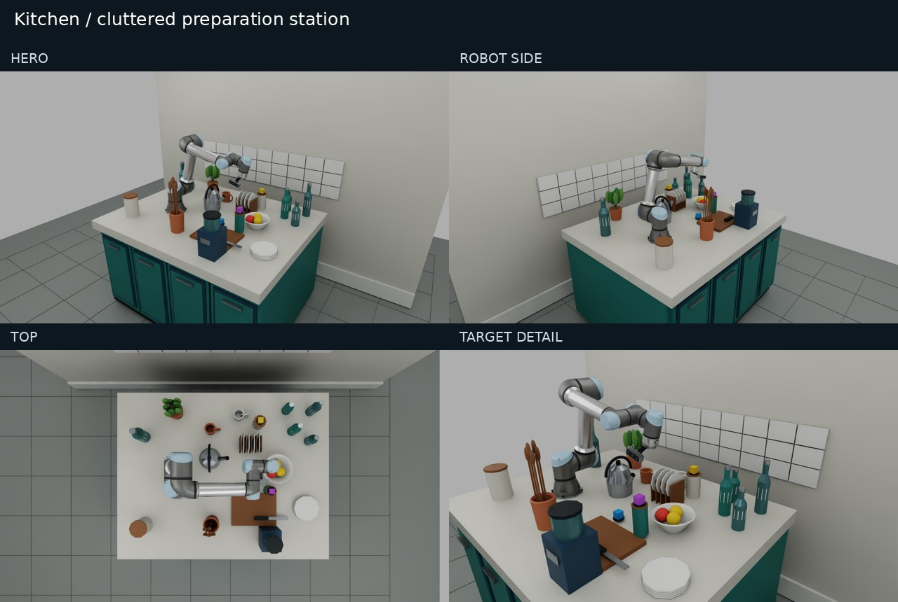
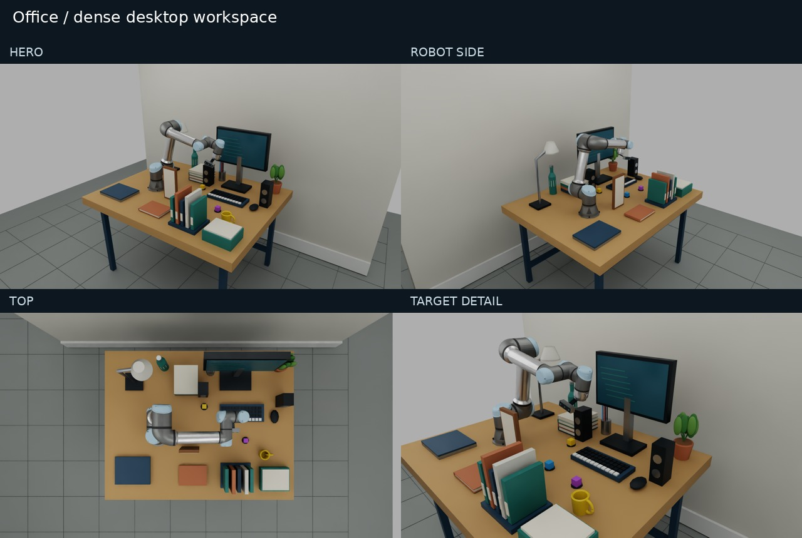
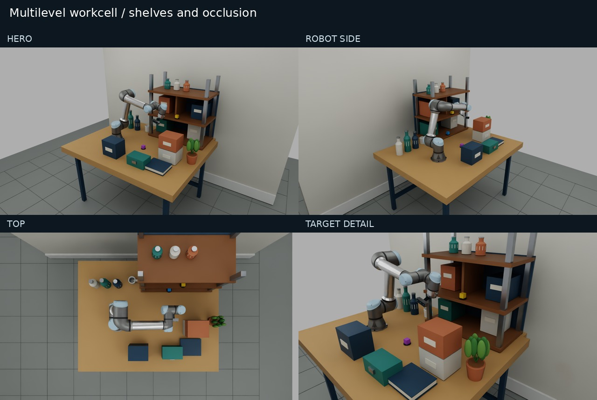

<div align="center">

# PRM Kit

**Multiobjective motion planning for robotics research.**

Build environments · Compare Pareto paths · Share reproducible results

[**Get started**](docs/GETTING_STARTED.md) · [Capabilities](docs/CAPABILITIES.md) · [Research examples](docs/RESEARCH_EXAMPLES.md) · [Download](https://github.com/CaptJack3/multiobjective-prm-kit/releases/latest) · [עברית](START_HERE_HE.md)

</div>

<!-- PROJECT_VIDEO_START -->

https://github.com/user-attachments/assets/331acb83-4525-439c-970d-568803ff2548

<!-- PROJECT_VIDEO_END -->

<p align="center"><em>Watch the project demo, then explore the environments below.</em></p>

| Kitchen | Workbench | Shelves |
| :---: | :---: | :---: |
| [](examples/research_showcase/scenes/kitchen/preview.jpg) | [](examples/research_showcase/scenes/office/preview.jpg) | [](examples/research_showcase/scenes/shelves/preview.jpg) |

<p align="center"><strong>7 environments</strong> · <strong>21 saved routes</strong> · <strong>10 USD stages</strong></p>

A portable Python toolkit for multiobjective probabilistic roadmaps, configurable
wall environments, static Isaac/USD scenes, and saved trajectory analysis.
Includes the UR5e, Robotiq 2F-85, D435 and PickNik assembly used in the project.
Explore the [scene collection and videos](docs/RESEARCH_EXAMPLES.md), or run your
first experiment below.

## First successful run

Use **Linux or WSL with Python 3.11** for the robot workflow. This CPU example
needs no GPU, Isaac Sim installation, historical research files or lab server.

```bash
git clone https://github.com/CaptJack3/multiobjective-prm-kit.git
cd multiobjective-prm-kit
python3.11 -m venv .venv
source .venv/bin/activate
python -m pip install -e '.[robot,render,usd]'
prmkit doctor
prmkit run examples/01_single_wall.yaml --output runs/first_wall
```

Open **`runs/first_wall/explorer/explore.html`** in your browser. You should see a
small completed experiment, a saved path, its objective values and a separate
mesh-verification result. This installation example uses N=24 and K=6.

For a lighter start without robot dependencies, see the
[point-robot quickstart](docs/GETTING_STARTED.md#lightweight-installation-check).
Using a remote server or downloading a ZIP? The same guide explains both.

## Choose a workflow

| I want to… | Start with |
|---|---|
| Plan in one wall environment | `prmkit run examples/01_single_wall.yaml` |
| Generate environments without solving PRM | `prmkit generate` or the [two-wall XY generator](docs/RECIPES.md#generate-a-two-wall-xy-grid-without-prm) |
| Compare multiple environments, queries or N/K settings | `python run_experiment.py --plan`, then [run a study](docs/CASES.md) |
| Import a static scene from Isaac Sim | `prmkit import-usd` · [import guide](docs/ISAAC_IMPORT.md) |
| Open or recreate kitchen, workbench and shelf scenes | [Research scene collection](docs/RESEARCH_EXAMPLES.md) |
| Verify, compare, select and export paths | [Run → verify → explore → select → export](docs/WORKFLOW.md) |
| Make a trajectory preview video | `prmkit render` · [recipe](docs/RECIPES.md#view-and-export-a-planned-path) |
| Change objectives or use another robot | [Objectives](docs/OBJECTIVES.md) · [extension guide](docs/EXTENDING.md) |

[Full capability and command map](docs/CAPABILITIES.md) ·
[One-page Hebrew PDF](docs/PRMKIT_CAPABILITIES_HE.pdf)

## Research examples included

The collection includes **seven environments**, ten self-contained USD stages,
21 saved preference routes with Isaac RTX videos, and a before/after smoothing
example. Start with the [example guide](docs/RESEARCH_EXAMPLES.md).
After cloning, open `examples/research_showcase/index.html` for the offline gallery.
GitHub shows HTML source; download or clone before opening an HTML guide.

The original USD scenes and later route videos use different documented hardware
revisions. Every example identifies its revision and what can be reproduced.
Historical results illustrate the research; they are not all exposed as commands
in the portable toolkit. No large roadmap or model-training weights are included.

## Learn and extend

- **New student:** [Getting started](docs/GETTING_STARTED.md) → [recipes](docs/RECIPES.md) → [reading results](docs/RESULTS.md).
- **Researcher:** [Case studies](docs/CASES.md), [configuration](docs/CONFIGURATION.md), [verification](docs/VERIFICATION_AND_CLEARANCE.md), [reproducibility](docs/REPRODUCIBILITY.md).
- **Developer:** [Contributing](CONTRIBUTING.md), [extension points](docs/EXTENDING.md), [architecture](ARCHITECTURE.md).
- **All guides:** [Documentation index](docs/README.md) · [troubleshooting](docs/TROUBLESHOOTING.md).

## Scope and validation

The toolkit plans and evaluates geometric paths. Its independent COAL mesh
postcheck samples a path; it is not continuous mesh collision detection or a
physical execution certificate. Isaac import handles supported **static geometry**.
The built-in renderer produces CPU mesh previews; the archived research videos
were rendered separately with Isaac RTX.

Changes to scene, query or N/K build another roadmap. Epsilon searches can reuse
one stored graph; incremental densification and a shared graph across scenes or
queries are not implemented. Start with small N/K before scaling up.

See [validation evidence](VALIDATION.md), [release checks](docs/RELEASE_VALIDATION.md)
and the [documented limits](docs/CAPABILITIES.md#boundaries).

## Attribution

Originally developed by Yaacov as part of his Master's final project at the Technion,
under the supervision of Prof. Oren Salzman, for research in multiobjective motion
planning and preference-conditioned robotic manipulation.

Source and asset origins are documented in
[PROVENANCE.json](PROVENANCE.json) and
[THIRD_PARTY_NOTICES.md](THIRD_PARTY_NOTICES.md).

Questions or problems? [Open an issue](https://github.com/CaptJack3/multiobjective-prm-kit/issues/new/choose)
with your configuration, `prmkit doctor` output and the relevant error.
